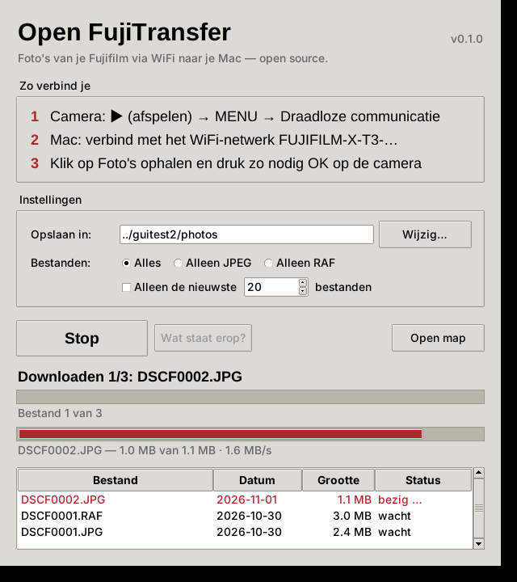

# Open FujiTransfer

**Foto's van je Fujifilm-camera via WiFi naar je Mac — open source, zonder de Fujifilm X App.**



Gemaakt voor de **X-T3**, en bedoeld voor X-camera's met *Draadloze communicatie*
(X-T2, X-T3, X-H1, X-Pro2/3, X-T30, X-S10, …).

> ⚠️ **Status: vroege versie.** Getest tegen een gesimuleerde camera, nog niet tegen
> elke echte camera. Werkt het bij jou (niet)? Open een issue met je cameramodel.

## Installeren

1. Download de nieuwste `.dmg` bij [Releases](../../releases)
   (`arm64` = Apple Silicon M1/M2/M3/…, `x86_64` = Intel-Mac).
2. Sleep **Open FujiTransfer** naar *Programma's*.
3. De app is niet bij Apple geregistreerd, dus macOS blokkeert hem de eerste keer.
   Open hem één keer via **rechtsklik → Open**, of via *Systeeminstellingen →
   Privacy en beveiliging → Toch openen*. Lukt dat niet:
   ```bash
   xattr -dr com.apple.quarantine "/Applications/Open FujiTransfer.app"
   ```
4. Vraagt macOS om toegang tot het **lokale netwerk**: kies *Sta toe*. Zonder die
   toestemming kan de app de camera niet bereiken.

## Gebruiken

1. **Camera:** ▶ (afspelen) → MENU → **Draadloze communicatie**. De camera toont
   een netwerknaam als `FUJIFILM-X-T3-XXXX`.
2. **Mac:** verbind via het WiFi-icoon met dat netwerk. (Je hebt zolang geen
   internet; dat hoort zo.)
3. Klik in de app op **Foto's ophalen**. Vraagt de camera om bevestiging, druk op **OK**.

Foto's komen in `~/Pictures/Open FujiTransfer/JJJJ-MM-DD/`. Wat je al hebt (zelfde
naam en grootte) wordt overgeslagen, dus je kunt elke keer gewoon alles ophalen.
De app onthoudt je doelmap en keuzes.

- **Wat staat erop?** — toont de kaart zonder te downloaden.
- **Alleen JPEG / RAF**, **alleen de nieuwste N** — voor als je haast hebt.

### RAW-bestanden

In de smartphone-modus biedt de X-T3 over WiFi meestal alleen JPEG's aan. Zie je je
RAF's niet in de lijst, dan is dat de camera, niet de app.

## Command line

Dezelfde app werkt ook in de terminal, vanuit de broncode (Python 3.9+, geen
dependencies):

```bash
python3 -m open_fujitransfer --list           # wat staat erop
python3 -m open_fujitransfer                  # zonder argumenten: het venster
python3 -m open_fujitransfer --out ~/Desktop/shoot --only jpg --latest 20
python3 -m open_fujitransfer --list --verbose # alle pakketten, om te debuggen
```

Of met de geïnstalleerde app:
`"/Applications/Open FujiTransfer.app/Contents/MacOS/Open FujiTransfer" --list`

## Werkt het niet?

```bash
python3 -m open_fujitransfer --list --verbose 2> log.txt
```

en voeg `log.txt` toe aan een issue. Veelvoorkomend:

- *Kan de camera niet bereiken* — staat je Mac op het WiFi van de camera? Heb je de
  app toegang gegeven tot het lokale netwerk (Systeeminstellingen → Privacy en
  beveiliging → Lokaal netwerk)?
- *Camera antwoordt niet* — zet de draadloze modus op de camera uit en weer aan.

## Hoe het werkt

De camera is een WiFi-accesspoint op `192.168.0.1`. Op TCP-poort 55740 praat hij een
Fuji-variant van PTP/IP: een eigen init-pakket, daarna gewone PTP USB-containers
over TCP. De app opent een sessie, wacht op toestemming, zet de camera in
galerijmodus (camera's zoals de X-T3 willen daarvoor eerst kort de liveview open en
dicht), vraagt per foto de `ObjectInfo` op en downloadt in blokken van 1 MB met
`GetPartialObject`.

```
open_fujitransfer/
  protocol.py   het Fuji WiFi-protocol (sockets, PTP-pakketten)
  sync.py       'haal alles op'-logica, gedeeld door app en CLI
  gui.py        het venster (Tkinter)
  cli.py        de terminalversie
tests/
  fake_camera.py  nep-camera om zonder echte camera te testen
  test_sync.py    tests (python3 -m unittest discover -s tests)
packaging/      PyInstaller-recept en build-script voor de .app/.dmg
```

## Zelf bouwen

```bash
python3 -m unittest discover -s tests -v      # tests
python3 -m pip install pyinstaller
bash packaging/build_macos.sh                 # → dist/OpenFujiTransfer-…-macos-<arch>.dmg
```

GitHub Actions bouwt bij elke push beide Mac-versies (zie het tabblad *Actions*).
Een release met de `.dmg`'s maak je door een tag `v…` te pushen, of via
*Actions → Test en bouw → Run workflow* met **release** aangevinkt (dan wordt de
versie uit `open_fujitransfer/__init__.py` de tag).

## Wat nog kan

- **Via je thuis-WiFi** ("PC AUTO SAVE"): camera en Mac op hetzelfde netwerk, je
  houdt internet. Het protocol staat beschreven in libfuji (`docs/autosave.md`).
- Thumbnails in de lijst, alleen geselecteerde foto's ophalen.

## Credits & licentie

MIT. Het reverse-engineeren van het protocol is het werk van Daniel Cook:
[libfuji](https://github.com/petabyt/libfuji) (MIT) en
[camlib](https://github.com/petabyt/camlib) (Apache-2.0). Ook nuttig:
[fuji-cam-wifi-tool](https://github.com/hkr/fuji-cam-wifi-tool).
Niet verbonden aan of goedgekeurd door FUJIFILM. Fujifilm en X-T3 zijn merken van
FUJIFILM Corporation.
